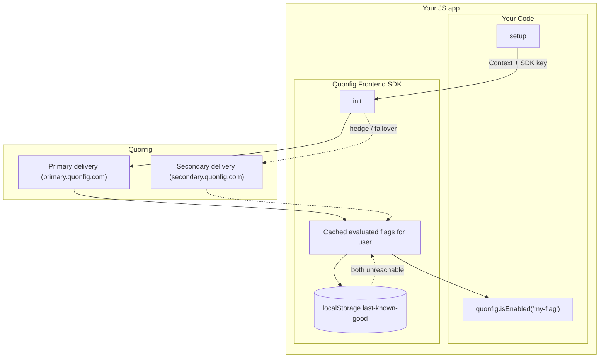

## Frontend Architecture

:::info

To prevent accidentally leaking sensitive config information, frontend SDKs do not receive Configs by default. You can enable frontend availability for any individual config using the "Send to frontend SDKs" checkbox in the Quonfig UI.

:::

## Frontend SDK keys (`qf_pk_…`)

Frontend SDKs (browser, React, React Native) authenticate with a **frontend SDK
key** (`qf_pk_…`), generated from the **SDK Keys** page in the dashboard. It is
safe to ship in browser bundles because the server only returns evaluated values
to it — never your raw rules (see [evaluation happens server side](#frontend-architecture)
below). For how it differs from the backend key and the other credentials, see
[Keys & Credentials](/docs/explanations/concepts/keys-and-credentials).

The frontend architecture has different goals and operating characteristics from the backend SDKs. The goals of the clients are:

1. Make lookups as fast as possible
2. Don't leak raw configuration data to the end user
3. Give clear and configurable behavior options if a connection cannot be made

With those goals in mind, the architecture is:



Usually, clients make a single request and receive the values of all evaluated Feature Flags for a given context. For reliability, the request goes to the primary delivery service first; if the primary is slow or down, the client also asks the secondary, which runs on separate infrastructure, and takes whichever answers first. See [Reliability](/docs/explanations/architecture/resiliency) for the full model.

If you change a context’s attributes and re-initialize the client, we'll re-fetch the flags for that context.

Note that **evaluation happens server side**. This prevents your potentially sensitive rule data from leaking to an untrusted browser. For example, if you
have a `special-feature` released to a list of customer IDs, the browser will only see `special-feature: false`, not the list of your special customer IDs.

The client will be returned a list that is basically:

```json
{
  "feature.exp12-big-button": "control",
  "feature.exp14-button-class": "very-blue",
  "feature.risky-business": true
}
```

Because the client only holds values evaluated for one context, frontend SDKs have no per-evaluation context: `get()` and `isEnabled()` take a key, not a context. To evaluate against a different context, see [React](/docs/sdks/react#evaluating-with-a-different-context) or [JavaScript](/docs/sdks/javascript#evaluating-with-a-different-context).

See [backend SDKs](/docs/explanations/concepts/backend-sdks.md) to compare this approach to in-memory rule evaluation.

## Client Side Reliability

The primary delivery service runs on a global network to keep latency low. The secondary is an identical delivery surface on separate infrastructure that serves evaluations if the primary is slow or down.

Each end-user that needs flags evaluated is a different request to Quonfig. So what happens if both the primary and the secondary are unreachable?

The browser SDK keeps the last configuration it received for a context in `localStorage`, so a returning visitor starts on that cached copy (marked stale) even if both delivery legs are unreachable.

A first-time visitor (or a [context](/docs/explanations/concepts/context) this browser hasn't cached) has no such copy. The client retries until `initTimeout` (5 seconds by default; each request leg also has its own 3-second `timeout`), and then applies your `onInitFailure` setting. The default, `fail`, rejects `init()`; `continue` starts on your code defaults instead. Either way the client keeps retrying in the background and switches to live values once it can reach us. See [Startup failure](/docs/explanations/architecture/startup-failure#browsers-and-mobile-apps) for how to choose.

Without values, your `isEnabled` checks will return `false`.

Frontend config will return `undefined`, and you can use the pattern `quonfig.get("thing") ?? "this-is-my-default"` to set a default.

Our [JavaScript SDK can also bootstrap][bootstrap] server-evaluated values into the page for an instant first render. If you have questions about our reliability roadmap, contact us, and we'll share what we're working on.

[bootstrap]: /docs/sdks/javascript#bootstrapping
