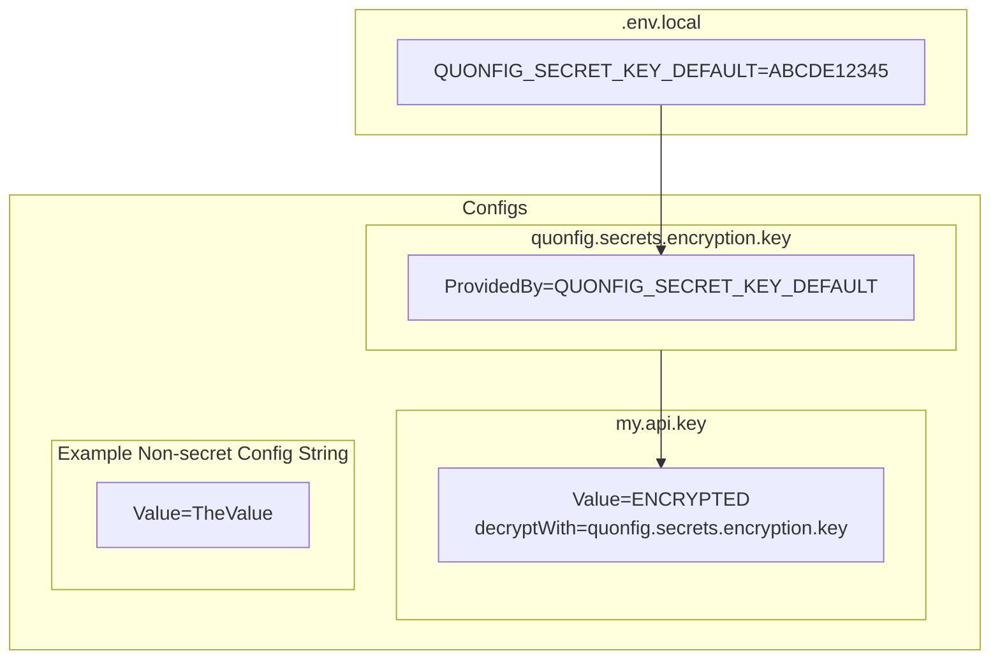
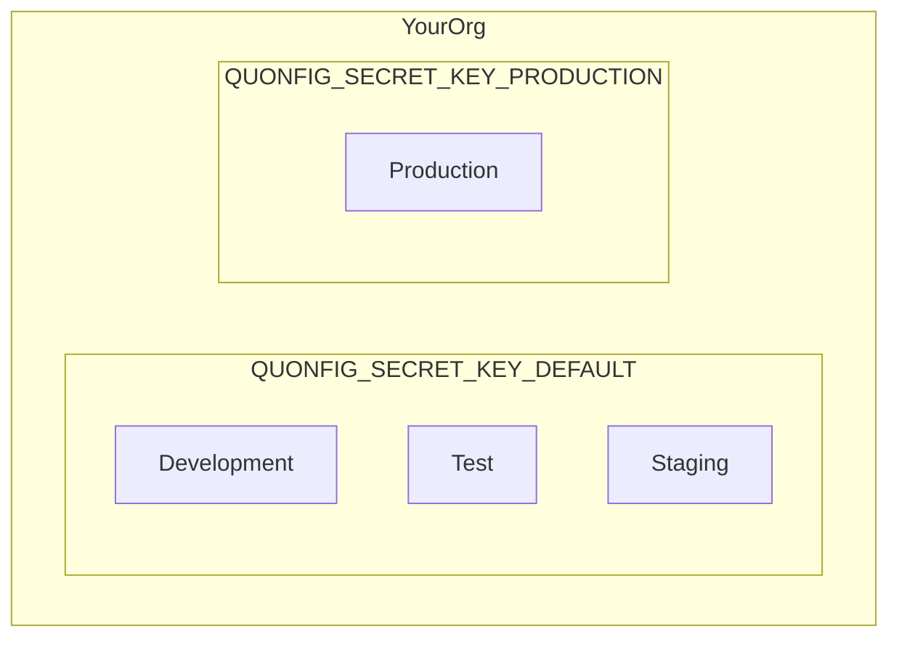
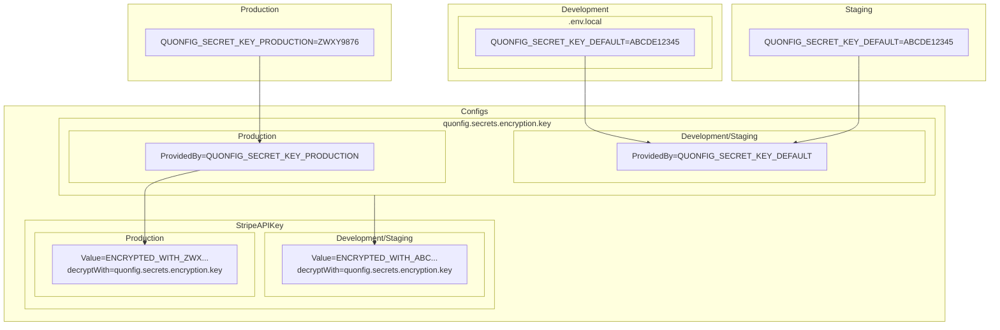

Quonfig has zero-knowledge support for [sharing your secrets](https://quonfig.com/features/secret-management/) between developers and between your different applications. We use simple & straightforward cryptography and Quonfig never sees anything unencrypted. This simplifies sharing secrets for local development and sharing secrets between multiple applications or languages because you only need a single encryption/decryption secret. (Multiple secrets is perfectly fine too, use as many as you require).

Quonfig owns:
- CLI to locally encrypt and push to Quonfig
- Distributing the encrypted values to your systems
- SDKs to decrypt `Quonfig.get("my-secret") => "the message"`

You own:
- Sharing the encryption/decryption secret(s) with the correct people / services

## How Does It Work

1. You create a `secret key` with the CLI. This is a series of random bytes that you keep secret.
2. This `secret key` needs to be available on developer machines to encrypt and in deployed environments to decrypt, you do this via your existing process for sharing environment variables.
3. You use our [CLI](/docs/tools/cli) to encrypt the string you want to keep secret.
4. Quonfig will share the encrypted contents with your applications.
5. Your applications will decrypt the contents with the `secret key`.

## What Does That Look Like?
[](https://www.youtube.com/watch?v=el_IEDCfoIU)

## Walkthrough

Quonfig secret management uses standard Quonfig dynamic configuration to store and share your secrets between your applications.

In particular, it uses two special types of configuration attributes: `decryptWith` and `provided`. Let's see how these work together.

### Step 1: Create an Encryption Key

:::info Already have an encryption key?
Most workspaces need only one. Check with `qfg info quonfig.secrets.encryption.key`: if it exists, it names the env var it is provided by. Make sure that variable is set in your shell (`[ -n "$QUONFIG_SECRET_KEY_DEFAULT" ] && echo set`, with your variable's name) and skip to [Step 2](#step-2-encrypt-something). Don't create the key again; `qfg create` refuses a key that already exists.
:::

Quonfig allows you to declare that a configuration value will be *"provided by"* an environment variable. Quonfig will store a config that is kind of an empty vessel. It is a pointer that says "find my value from this ENV VAR".

We want Quonfig to have zero knowledge of your encryption key, so we'll use these provided values so you don't have to tell us the encryption key.

#### Create the Provided By Env Var Config

```bash
qfg create quonfig.secrets.encryption.key --env-var=QUONFIG_SECRET_KEY_DEFAULT --type string --confidential
```

This creates:
1. A config called `quonfig.secrets.encryption.key`
2. That will resolve to `QUONFIG_SECRET_KEY_DEFAULT`
3. That won't report/print the value because it's `--confidential`

#### Put something in the vessel locally

We'll generate a secure series of random bytes to be our encryption key.
```bash
> qfg generate-new-hex-key
17f65155e45a42777d89091e40cddc5541ac4851c44134f86db7a408a7fea5a8
```

Now we put this into our environment using something like a `.env.local` file.
```bash
#.env.local
QUONFIG_SECRET_KEY_DEFAULT=17f65155e45a42777d89091e40cddc5541ac4851c44134f86db7a408a7fea5a8
```

If we run our application now and call `Quonfig.get("quonfig.secrets.encryption.key")` we'll get `17f65155e45a42777d89091e40cddc5541ac4851c44134f86db7a408a7fea5a8`.


## Step 2: Encrypt Something

#### Encrypt a value

`qfg create --secret` creates a string config whose value is encrypted on your machine before anything is sent. Run it with no value and it asks for one; what you type shows only as `*`:

```bash
qfg create my.api.key --secret
```

This will:
1. Assume that we are using the value of `quonfig.secrets.encryption.key` to encrypt.
2. Pull the key from our environment.
3. Use that key to encrypt the value you entered.
4. Push an encrypted blob to Quonfig under the key `my.api.key`.

The command never prints the value back. It confirms with a redacted fingerprint instead, something like `[encrypted *****3fa9c, 51 chars, ends …a1b2]` (see [Checking a secret without revealing it](#checking-a-secret-without-revealing-it)).

:::info Secrets are always strings
A secret is a `string` config, and the SDKs return the decrypted value as a string. `--secret` works with `--type string` only, and you don't need to pass the type: `create --secret` uses `string`. To keep structured data secret, [store JSON as a string secret](#storing-json-in-a-secret).
:::

#### Keep the value out of your shell history

`--value="..."` works, but it puts the plaintext in your shell history, in the process list while the command runs, and in any terminal log or recording. For scripts, CI and anything you paste, pass the value one of these ways instead:

```bash
# From an environment variable already set (and exported) in this shell
qfg create my.api.key --secret --value-from-env STRIPE_SECRET_KEY

# Load a .env file first without printing it: `set -a` exports what it sets
set -a; source ./.env.local; set +a

# From stdin: a file, a pipe, or a password manager's CLI
qfg create my.api.key --secret --value-stdin < ./stripe-key.txt
op read "op://Engineering/Stripe/secret key" | qfg create my.api.key --secret --value-stdin
```

- `--value-from-env <VAR>` reads the value from a variable in **your local environment, once, at the moment you run the command**. It fails if the variable is unset or empty. The variable must be exported: a plain `source file.env` of `KEY=value` lines sets shell variables that `qfg` can't see, so use `set -a; source file.env; set +a` or `export VAR`.
- `--value-stdin` reads the value from stdin and strips one trailing newline, so `echo`-style input and files that end in a newline store what you expect. If stdin is your terminal rather than a pipe or file, it asks for the value without echoing it.

Both work on `qfg create` and `qfg set-default`, with or without `--secret`, and you pass only one of `--value`, `--value-stdin`, `--value-from-env` and `--env-var`.

Don't confuse `--value-from-env` with `--env-var`. `--env-var=DATABASE_URL` stores no value at all: it saves a pointer, and your application reads `DATABASE_URL` from **its own** environment every time it runs (that's how the encryption key in Step 1 works). `--value-from-env` copies the variable's current value into Quonfig, encrypted when you add `--secret`.


Here's a pictorial representation of what we've done so far



## Step 3: Using the Secret

Locally, we're all set. We can use the language appropriate form of `Quonfig.get("my.api.key")` and the library will decrypt our secret.

To use the secret in another environment, you just need to get `QUONFIG_SECRET_KEY_DEFAULT=17f65155e45a42777d89091e40cddc5541ac4851c44134f86db7a408a7fea5a8`
set in that environment.

## Separate Keys For Different Environments

So far, we've shared the same secret for development and staging, but it's very likely you'll want a different key for your production secrets. This is no problem. The nature of `provided` means that our `quonfig.secrets.encryption.key` can resolve to different ENV vars in different environments.

#### Generate a second secret
```bash
> qfg generate-new-hex-key
17f65155e45a42777d89091e40cddc5541ac4851c44134f86db7a408a7fea5a8
```

#### Put that secret into a separate env var

Why use a second env var? Well, you aren't required to. You could share the same name for the env var in all your environments.

The trick is that this can make using the CLI locally more challenging. Locally, the CLI will need to be able to encrypt for both the default and production environments. We find it is easier to have them use different names so they don't collide locally. Here's what that looks like

```bash
#.env.local
QUONFIG_SECRET_KEY_DEFAULT=17f65155e45a42777d89091e40cddc5541ac4851c44134f86db7a408a7fea5a8
QUONFIG_SECRET_KEY_PRODUCTION=994899132443777d89091e40cddc5541abdeff123830488a7fea173b3b1b2b38
```

#### Update the quonfig.secrets.encryption.key to look for the other ENV var in production
```bash
$ qfg set-default --confidential --env-var=QUONFIG_SECRET_KEY_PRODUCTION

? Which item would you like to change the default for? quonfig.secrets.encryption.key
? Which environment would you like to change the default for? Production
Confirm: change the default for quonfig.secrets.encryption.key in Production to be provided by `QUONFIG_SECRET_KEY_PRODUCTION`? yes/no: yes
✔ Successfully changed default to be provided by `QUONFIG_SECRET_KEY_PRODUCTION` (confidential)
```

Using one key for every environment is fine too; then there's nothing to do here, and production secrets are encrypted with the same `QUONFIG_SECRET_KEY_DEFAULT`.

This is now the mapping of environment to ENV Var.


We can also see this by running `qfg info`.
```bash
$ qfg info quonfig.secrets.encryption.key

- Default: `QUONFIG_SECRET_KEY_DEFAULT` via ENV
- Development: [inherit]
- Production: `QUONFIG_SECRET_KEY_PRODUCTION` via ENV

No evaluations in the past 24 hours
```


#### Set a Secret in Production

Finally, let's set a production secret.

```bash
qfg set-default my.api.key --environment=production --secret --value-from-env STRIPE_LIVE_KEY --confirm
```

The value is encrypted with the key `quonfig.secrets.encryption.key` resolves to in production (`QUONFIG_SECRET_KEY_PRODUCTION`), so that variable has to be set in your shell. `--confirm` skips the confirmation prompt; without it, a non-interactive run (a script, CI, an agent) stops and asks you to pass it. The confirmation prompt and the success line show the redacted fingerprint, never the plaintext:

```
✔ Set production fallback to [encrypted *****3fa9c, 51 chars, ends …a1b2].
```

Rotating a secret is the same command with the new value. A few things to know:

- Once a config holds an encrypted value, `set-default` encrypts new values for it automatically, even without `--secret`.
- If production had no rules of its own, they're copied from the default first, and the command says so.
- To change the default that every environment without its own rules inherits, use `--environment="[Default]"`.
- If you run `set-default` interactively on a secret, the value prompt shows only `*`.

:::tip
Note: You can use as many encryption keys as you want. It is a common practice to have 2, one for production and one for all other environments. But you can have as many secrets as you need in order to align with the trust groups you require.
:::

## Checking a secret without revealing it

`qfg get` on a secret prints a redacted form, not the plaintext:

```bash
$ qfg get my.api.key --environment=production
my.api.key is a secret: value redacted. A human can pass --reveal to print the plaintext (never do this in an agent session or CI log).
[encrypted *****3fa9c, 51 chars, ends …a1b2]
```

The redacted line is the only thing on stdout; the note is on stderr.

That line gives you enough to confirm you set the right thing without showing the value:

- **Fingerprint** (`*****3fa9c`): `*****` followed by the first 5 hex characters of the MD5 of the stored **encrypted** value. The SDKs use the same fingerprint when they report evaluations of confidential values in telemetry, so you can match what the CLI shows against what your applications saw. Encryption is randomized, so every write gets a new fingerprint even when the plaintext hasn't changed: a new fingerprint means a new write landed. It can't tell you whether two environments hold the same plaintext.
- **Length**: the number of characters in the plaintext.
- **Last 4** (`ends …a1b2`): the last four characters of the plaintext, so you can check it against the source (most dashboards show the last four of an API key). It's shown only when the value is at least 12 characters long; for shorter values, four characters would give away too much.

To print the decrypted value, add `--reveal`:

```bash
qfg get my.api.key --environment=production --reveal
```

With `--json`, a secret comes back as `{"redacted": true, "encrypted": true, "fingerprint": "...", "length": 51, "last4": "..."}` instead of the value (no `last4` for short values), unless you pass `--reveal`. A `--confidential` value that isn't encrypted is redacted the same way, with `"encrypted": false`. Configs that aren't secrets print exactly as before, and [`qfg run`](/docs/tools/qfg-run) still injects decrypted values into the child process's environment without printing them.

## Storing JSON in a secret

Secrets are strings, so there's no `json` secret type. Store the JSON document as a string secret and parse it in your application:

```bash
qfg create payments.provider.credentials --secret --value-stdin < ./credentials.json
```

```typescript
const credentials = JSON.parse(quonfig.get("payments.provider.credentials"));
```

`set-default --secret` on a config that was created as `json` (or any other non-string type) is refused with an error that says so. Create a new string secret for the value instead.

## Using secrets with AI agents

An agent's shell commands and their output usually end up in a transcript, a log, or a model's context. Treat everything an agent runs or prints as visible to others.

- **Never put a secret in a command line.** `--value=sk_live_...` lands in the transcript the moment the agent writes it. Have the agent use `--value-from-env <VAR>` with a variable you set yourself, or `--value-stdin` fed from a file or password manager.
- **Verify with the fingerprint.** `qfg get <key> --environment=<env>` shows the fingerprint, length and last 4, which is enough to confirm the write. An agent can also compare length and last 4 against the source variable without printing it: `[ "${#STRIPE_LIVE_KEY}" = 107 ] && [ "${STRIPE_LIVE_KEY: -4}" = a1b2 ] && echo match`. An agent should never pass `--reveal`.
- **Don't read secret files.** An agent shouldn't `cat` a `.env` file or print the encryption key variables. `qfg create` and `qfg set-default` read the key from the environment themselves.
- **Run, don't print.** To give a build step or migration a secret, use [`qfg run`](/docs/tools/qfg-run), which puts the value in the child process's environment without printing it.

For a coding agent, the [Quonfig agent skill](/docs/tools/agent-skill) includes these rules.


## Full Example Diagram




## How should I get the actual Secret keys passed around.

In order to share the `QUONFIG_SECRET_KEY_DEFAULT` with developers, you can use a password manager such as 1Password or you can use one of the secure 1-time password sharing website like [1ty.me](https://1ty.me/) [onetimesecret](https://onetimesecret.com/) or [password.link](https://password.link/).

This will be the only secret you ever need to share amongst your developers going forward.


## How do secrets work in  CI?

Because Quonfig secret management uses the regular dynamic configuration, you'll use the same techniques to run in continuous integration environments which may be offline. The full guide is available in [Testing](/docs/explanations/concepts/testing). The only thing you'll need to remember is to make `QUONFIG_SECRET_KEY_DEFAULT` available to processes in CI.

:::tip Migrations and build steps
For tools that read secrets from `process.env` *before* the SDK can initialize — `drizzle-kit migrate`, `next build`, `next-auth`'s `AUTH_SECRET`, and similar — use [`qfg run`](/docs/tools/qfg-run) to resolve Quonfig configs into env vars and exec the child process. Avoid hand-rolling a `with-quonfig-env.ts` wrapper script; `qfg run` handles the resolve, the env merge, and the binary auth/environment rule for you.
:::
